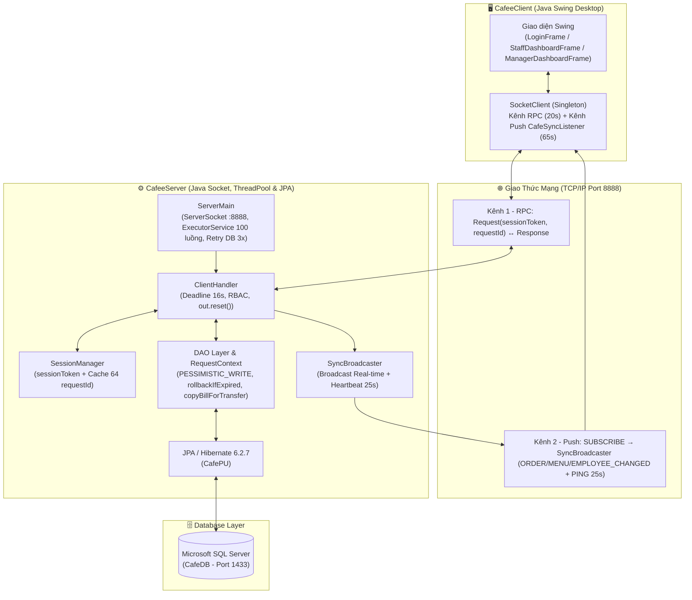
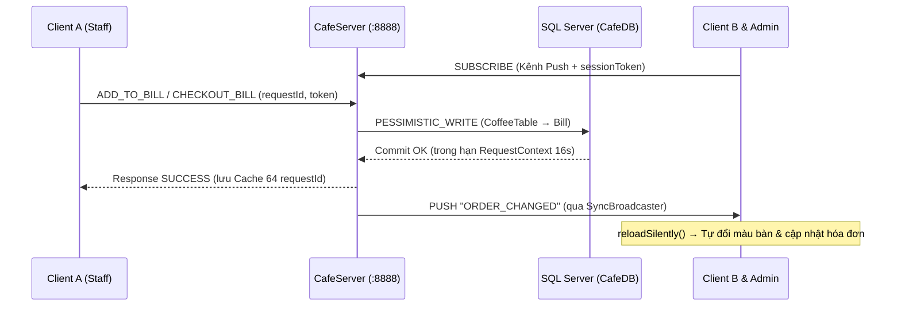
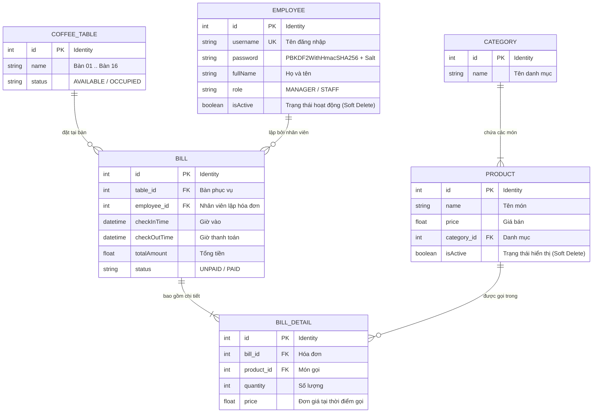

# ☕ Hệ Thống Quản Lý Bán Cafe (Coffee Management System)
### Đồ Án Môn Học: Lập Trình Phân Tán (Distributed Programming) - FIT IUH

[](https://www.oracle.com/java/)
[](https://hibernate.org/orm/)
[](https://jakarta.ee/specifications/persistence/)
[](https://www.microsoft.com/en-us/sql-server)
[](https://docs.oracle.com/javase/8/docs/technotes/guides/swing/)
[](https://maven.apache.org/)

---

## 📖 Giới Thiệu Tổng Quan

**Coffee Management System** là ứng dụng quản lý quán cà phê theo kiến trúc **Client - Server phân tán** sử dụng giao thức **Java TCP Socket (cổng `8888`)**, được tách thành hai dự án độc lập **`CafeeServer`** và **`CafeeClient`** giao tiếp qua thư viện chung `cafe-common.jar`. Hệ thống giải quyết bài toán đồng bộ **real-time** giữa nhiều máy trạm (nhân viên phục vụ, thu ngân, quản lý) mà không cần bấm Refresh thủ công, đồng thời đảm bảo an toàn giao dịch đồng thời thông qua **JPA / Hibernate ORM 6.2** trên **Microsoft SQL Server (`CafeDB`)**.

### 🌟 Điểm Nổi Bật
* **Kiến Trúc Phân Tán 2 Kênh TCP (`RPC` + `Push`):**
  * **Kênh RPC (`20s` read timeout):** Gửi `Request` và nhận `Response` có gắn `sessionToken` (UUID) và `requestId`.
  * **Kênh Push (`SUBSCRIBE`):** Luồng nền `CafeSyncListener` giữ kết nối dài hạn để nhận sự kiện đẩy tức thì (`ORDER_CHANGED`, `MENU_CHANGED`, `EMPLOYEE_CHANGED`) từ `SyncBroadcaster`, kèm heartbeat `PING` mỗi `25s` và tự động phát `ALL_REFRESH` khi nối lại mạng.
* **ThreadPool & Xử Lý Đồng Thời An Toàn:**
  * `ServerMain` sử dụng `ExecutorService` giới hạn **`100` luồng** xử lý đồng thời và tự retry kết nối CSDL tối đa `3` lần khi khởi động.
  * Khóa bi quan `LockModeType.PESSIMISTIC_WRITE` theo thứ tự cố định **`CoffeeTable -> Bill`** trong cả `addToBill()` và `checkoutBill()`, triệt tiêu deadlock khi nhiều nhân viên thao tác cùng bàn.
* **Phân Tầng Timeout & Chống Ghi Trùng (Idempotency):**
  * Thời gian chờ phân tầng tăng dần: `DB Lock (5s)` < `JPA Query (10s)` < `Server RequestContext (16s)` < `Client Socket Read (20s)`. Trước khi `commit()`, DAO kiểm tra `RequestContext.rollbackIfExpired()` để hủy giao dịch nếu quá hạn `16s`.
  * `SessionManager` lưu cache LRU `64 requestId` gần nhất cho các tác vụ ghi (`MUTATING_ACTIONS`), giúp `SocketClient` tự động reconnect giữ nguyên phiên khi rớt mạng mà không bị ghi trùng dữ liệu.
* **Bảo Mật & Phân Quyền Phía Server:**
  * Mật khẩu được băm bằng **`PBKDF2WithHmacSHA256`** (`65.536` vòng lặp + Salt `16` byte ngẫu nhiên) và tự động nâng cấp mật khẩu plain-text cũ khi đăng nhập.
  * Server kiểm tra quyền `MANAGER_ONLY_ACTIONS` ngay tại `ClientHandler`, chặn quản lý tự khóa tài khoản đang đăng nhập và thu hồi phiên ngay lập tức khi khóa nhân viên.
* **Khởi Động Nhanh & Data Seeder Tự Động:** Cấu hình `hibernate.hbm2ddl.auto = none` để rút ngắn thời gian mở Server, tự fallback `update` khi DB trống, sau đó `initDefaultData()` nạp sẵn **6 nhân viên, 16 bàn, 6 danh mục, 24 món và 6 hóa đơn mẫu**.
* **Khử Đệ Quy Circular Reference:** `OrderDao.copyBillForTransfer()` ngắt liên kết ngược `bd.setBill(null)` và tách proxy Hibernate (`EmployeeDao.sanitize()`) kết hợp `out.reset()`, loại bỏ lỗi `StackOverflowError` và cache tham chiếu khi truyền qua `ObjectOutputStream`.

---

## 🏗️ Kiến Trúc Hệ Thống (System Architecture)



### Luồng Đồng Bộ Real-Time Giữa Các Máy Trạm



### Phân Tách Các Thành Phần
* **`com.cafe.common` (Đóng gói trong `CafeeServer/export/cafe-common.jar` → `CafeeClient/lib/cafe-common.jar`):**
  * `entity`: Các Entity ánh xạ JPA (`Employee`, `Category`, `Product`, `CoffeeTable`, `Bill`, `BillDetail`).
  * `network`: Giao thức truyền tin qua Socket (`ActionType`, `Config`, `Request`, `Response`, `OrderDto`, `ChangePasswordDto`).
* **`com.cafe.server` (`CafeeServer`):**
  * `service`: `ServerMain` (khởi tạo JPA, Seeder, ThreadPool `100` luồng), `ClientHandler` (xử lý request, deadline `16s`, RBAC, `SUBSCRIBE`), `SessionManager` (quản lý phiên + idempotency), `SyncBroadcaster` (đẩy sự kiện real-time).
  * `dao`: `JPAUtil` (hỗ trợ `reinitializeWithSchemaUpdate()` khi DB trống), `RequestContext` (deadline transaction), `DaoResult`, `EmployeeDao`, `ProductDao`, `OrderDao`.
  * `util`: `PasswordUtil` (băm & kiểm chứng `PBKDF2WithHmacSHA256`).
* **`com.cafe.client` (`CafeeClient`):**
  * `ClientMain`: Thiết lập Look and Feel hệ thống và mở `LoginFrame`.
  * `socket.SocketClient`: Quản lý kết nối 2 kênh (RPC + Push nền `CafeSyncListener`), tự động reconnect giữ `sessionToken` và `requestId`.
  * `ui`: `LoginFrame`, `StaffDashboardFrame`, `ManagerDashboardFrame`, `ProductPanel`, `EmployeePanel`, `BillPanel`, `UIUtils`.

---

## 📊 Cơ Sở Dữ Liệu (Database Schema)

Hệ quản trị CSDL: **Microsoft SQL Server (`CafeDB`)**, ánh xạ qua **Hibernate ORM 6.2.7.Final**.



---

## 🎯 Tính Năng Chi Tiết (Features)

### 1. Đăng Nhập (`LoginFrame`)
* Giao diện tối giản với 2 trường **Tên tài khoản** và **Mật khẩu**, tự kết nối tới máy chủ qua `Config.SERVER_IP` : `Config.SERVER_PORT` (mặc định `127.0.0.1:8888`, hỗ trợ sửa IP trong `Config.java` khi chạy mạng LAN).
* Xác thực mật khẩu `PBKDF2WithHmacSHA256` ở phía Server, cấp `sessionToken` và tự động mở giao diện theo vai trò (`MANAGER` hoặc `STAFF`).

### 2. Phân Hệ Nhân Viên Bán Hàng (`StaffDashboardFrame`)
* **Sơ đồ 16 bàn đồng bộ real-time:**
  * 🟢 **Màu xanh lục (`AVAILABLE`):** Bàn trống, sẵn sàng phục vụ.
  * 🔴 **Màu đỏ (`OCCUPIED`):** Bàn đang có khách ngồi. Trạng thái đổi màu tức thì trên mọi máy trạm qua kênh Push `ORDER_CHANGED`.
* **Chi tiết Order & Gọi món cộng dồn:** Xem danh sách món hiện có của bàn, tự động tạo hóa đơn `UNPAID` mới khi bàn trống hoặc cộng dồn số lượng nếu món đã tồn tại. Thực đơn tự đồng bộ khi quản lý thêm/sửa/xóa món (`MENU_CHANGED`).
* **Thanh toán hóa đơn:** Khóa bi quan `CoffeeTable -> Bill`, chốt `checkOutTime`, cập nhật trạng thái `PAID` và trả bàn về `AVAILABLE`.
* **Tài khoản cá nhân:** Xem thông tin nhân viên và đổi mật khẩu có xác thực mật khẩu cũ qua `ChangePasswordDto`.

### 3. Phân Hệ Quản Trị Viên (`ManagerDashboardFrame`)
* **Quản Lý Thực Đơn (`ProductPanel`):**
  * Thêm, sửa món ăn/thức uống và chọn danh mục.
  * Xóa an toàn (**Soft Delete**) qua `isActive = false` để bảo toàn dữ liệu lịch sử hóa đơn cũ.
  * Tìm kiếm nhanh ngay trên bảng với `TableRowSorter`; thay đổi tự phát `MENU_CHANGED` đồng bộ sang các máy bán hàng.
* **Quản Lý Nhân Sự (`EmployeePanel`):**
  * Xem danh sách nhân viên, tạo tài khoản mới và phân quyền `STAFF` / `MANAGER` (mật khẩu mới băm bằng `PBKDF2WithHmacSHA256`).
  * Khóa tài khoản (`isActive = false`) thay vì xóa vật lý; chặn thao tác tự khóa chính mình và thu hồi phiên đăng nhập của tài khoản bị khóa ngay lập tức.
* **Quản Lý Lịch Sử Hóa Đơn & Doanh Thu (`BillPanel`):**
  * Hiển thị hóa đơn mới nhất lên đầu kèm tổng doanh thu các đơn `PAID`, tự động tải lại khi nhận sự kiện `ORDER_CHANGED` từ quầy thu ngân.

---

## 📡 Giao Thức Mạng & Các Hành Động (`ActionType`)

Tất cả yêu cầu giữa Client và Server được đóng gói trong `Request(action, payload, sessionToken, requestId)` và trả về `Response(success, message, data)`:

| ActionType | Quyền tối thiểu | Payload (Request) | Dữ liệu trả về (`Response.data`) |
| :--- | :--- | :--- | :--- |
| `LOGIN` | Công khai | `Employee` (`username`, `password`) | `Employee` đã làm sạch password + `sessionToken` |
| `LOGOUT` | Đã đăng nhập | `null` | `null` (hủy phiên & kênh Push) |
| `SUBSCRIBE` | Đã đăng nhập | `null` (kèm `sessionToken`) | Luồng Push chuỗi chủ đề (`ORDER_CHANGED`, `MENU_CHANGED`, `EMPLOYEE_CHANGED`, `PING`) |
| `GET_CATEGORIES` | `STAFF` / `MANAGER` | `null` | `List<Category>` |
| `GET_PRODUCTS` | `STAFF` / `MANAGER` | `null` | `List<Product>` |
| `GET_TABLES` | `STAFF` / `MANAGER` | `null` | `List<CoffeeTable>` |
| `GET_ACTIVE_BILL` | `STAFF` / `MANAGER` | `Integer` (`tableId`) | `Bill` (kèm `List<BillDetail>` đã khử đệ quy) |
| `ADD_TO_BILL` | `STAFF` / `MANAGER` | `OrderDto` (`tableId`, `productId`, `quantity`) | `null` (`success`/`message`) |
| `CHECKOUT_BILL` | `STAFF` / `MANAGER` | `Integer` (`tableId`) | `null` (`success`/`message`) |
| `CHANGE_PASSWORD` | `STAFF` / `MANAGER` | `ChangePasswordDto` (`oldPassword`, `newPassword`) | `null` (`success`/`message`) |
| `ADD_PRODUCT` | `MANAGER` | `Product` | `null` (`success`/`message`) |
| `UPDATE_PRODUCT` | `MANAGER` | `Product` | `null` (`success`/`message`) |
| `DELETE_PRODUCT` | `MANAGER` | `Integer` (`productId`) | `null` (`success`/`message`) |
| `GET_EMPLOYEES` | `MANAGER` | `null` | `List<Employee>` (đã làm sạch password) |
| `ADD_EMPLOYEE` | `MANAGER` | `Employee` | `null` (`success`/`message`) |
| `UPDATE_EMPLOYEE` | `MANAGER` | `Employee` | `null` (`success`/`message`) |
| `DELETE_EMPLOYEE` | `MANAGER` | `Integer` (`employeeId`) | `null` (`success`/`message`) |
| `GET_ALL_BILLS` | `MANAGER` | `null` | `List<Bill>` (sắp xếp mới nhất lên đầu) |

---

## 📁 Cấu Trúc Thư Mục Dự Án

```
Coffee-Management-Distributed-Programming/
│
├── CafeeServer/                                      # Project Server (Maven + JPA + Socket)
│   ├── src/main/java/com/cafe/
│   │   ├── common/
│   │   │   ├── entity/                               # Bill, BillDetail, Category, CoffeeTable, Employee, Product
│   │   │   └── network/                              # ActionType, ChangePasswordDto, Config, OrderDto, Request, Response
│   │   └── server/
│   │       ├── dao/                                  # DaoResult, EmployeeDao, JPAUtil, OrderDao, ProductDao, RequestContext
│   │       ├── service/                              # ClientHandler, ServerMain, SessionManager, SyncBroadcaster
│   │       └── util/                                 # PasswordUtil (PBKDF2WithHmacSHA256)
│   ├── src/main/resources/META-INF/
│   │   └── persistence.xml                           # Cấu hình kết nối SQL Server & timeout JPA/Hibernate
│   ├── export/
│   │   └── cafe-common.jar                           # Thư viện common đóng gói từ com.cafe.common
│   ├── CreateDB.sql                                  # Script khởi tạo CSDL CafeDB
│   └── pom.xml                                       # Khai báo dependencies (Hibernate 6.2.7, mssql-jdbc 12.2.0, Lombok)
│
├── CafeeClient/                                      # Project Client (Java Swing)
│   ├── lib/
│   │   └── cafe-common.jar                           # Bản dùng chung đồng bộ từ CafeeServer/export
│   └── src/com/cafe/client/
│       ├── ClientMain.java                           # Entry point khởi chạy Client UI
│       ├── socket/
│       │   └── SocketClient.java                     # Kết nối 2 kênh TCP (RPC + Push) & tự reconnect
│       └── ui/
│           ├── LoginFrame.java                       # Màn hình đăng nhập (Tài khoản / Mật khẩu)
│           ├── StaffDashboardFrame.java              # Giao diện Nhân viên & Sơ đồ 16 bàn real-time
│           ├── ManagerDashboardFrame.java            # Giao diện Quản trị (3 tab)
│           ├── ProductPanel.java                     # Quản lý thực đơn & lọc TableRowSorter
│           ├── EmployeePanel.java                    # Quản lý nhân sự & phân quyền
│           ├── BillPanel.java                        # Lịch sử hóa đơn & tổng doanh thu
│           └── UIUtils.java                          # Bảng màu, font, helper bất đồng bộ SwingWorker
│
├── Ứng Dụng Quản Lý Bán Cafe - Báo Cáo Đồ Án Lập Trình Phân Tán.pptx
├── .gitignore
└── README.md
```

---

## 🚀 Hướng Dẫn Cài Đặt & Chạy Ứng Dụng

### 1. Yêu Cầu Môi Trường
* **JDK:** Java Development Kit **17** hoặc cao hơn.
* **DBMS:** Microsoft SQL Server (đã bật chế độ `SQL Server and Windows Authentication mode` và giao thức TCP/IP tại cổng `1433`).
* **IDE Khuyên Dùng:** Eclipse IDE (cả `CafeeServer` và `CafeeClient` đã cấu hình sẵn `.project` / `.classpath`).

---

### 2. Thiết Lập Cơ Sở Dữ Liệu
Mở **SQL Server Management Studio (SSMS)** và chạy lệnh tạo cơ sở dữ liệu `CafeDB` (hoặc chạy tệp [`CafeeServer/CreateDB.sql`](CafeeServer/CreateDB.sql)):

```sql
CREATE DATABASE CafeDB;
GO
```

> [!NOTE]
> Mặc định `hibernate.hbm2ddl.auto` được đặt là `none` trong `persistence.xml` để khởi động nhanh. Nếu `CafeDB` chưa có bảng nào, `ServerMain` sẽ tự động chuyển qua `JPAUtil.reinitializeWithSchemaUpdate()` để tạo đầy đủ 6 bảng và chạy Seeder khởi tạo dữ liệu mẫu.

---

### 3. Cấu Hình Kết Nối CSDL & Mạng LAN
1. Mở [`CafeeServer/src/main/resources/META-INF/persistence.xml`](CafeeServer/src/main/resources/META-INF/persistence.xml) và chỉnh tài khoản SQL Server nếu khác mặc định:
```xml
<property name="jakarta.persistence.jdbc.url" value="jdbc:sqlserver://127.0.0.1:1433;databaseName=CafeDB;encrypt=false;trustServerCertificate=true;loginTimeout=45;queryTimeout=10;lockTimeout=5000;socketTimeout=45000;"/>
<property name="jakarta.persistence.jdbc.user" value="sa"/>
<property name="jakarta.persistence.jdbc.password" value="123456"/>
```
2. Nếu chạy Client từ máy khác trong mạng LAN, cập nhật `SERVER_IP` trong [`CafeeServer/src/main/java/com/cafe/common/network/Config.java`](CafeeServer/src/main/java/com/cafe/common/network/Config.java) (và đồng bộ lại `CafeeClient/lib/cafe-common.jar`), đồng thời mở cổng Firewall `8888` trên máy chạy Server.

---

### 4. Khởi Chạy Ứng Dụng

#### Cách 1: Chạy trực tiếp trong Eclipse (Khuyên dùng)
1. **Import 2 project:** `CafeeServer` (Maven Project) và `CafeeClient` (Java Project) vào Eclipse.
2. **Khởi chạy Server trước:** Mở `com.cafe.server.service.ServerMain` trong `CafeeServer` → **Run As → Java Application**. Chờ thông báo `Cafe Server is running on port 8888`.
3. **Khởi chạy nhiều Client để test đồng bộ real-time:** Mở `com.cafe.client.ClientMain` trong `CafeeClient` → **Run As → Java Application** (có thể mở song song cửa sổ `staff` và cửa sổ `admin`).

#### Cách 2: Chạy bằng dòng lệnh (PowerShell + Maven / JDK 17)
```powershell
# Terminal 1: Biên dịch & chạy CafeeServer
mvn -f CafeeServer/pom.xml compile
mvn -f CafeeServer/pom.xml exec:java -Dexec.mainClass="com.cafe.server.service.ServerMain"

# Terminal 2: Biên dịch & chạy CafeeClient
New-Item -ItemType Directory -Force -Path CafeeClient/bin | Out-Null
$clientFiles = (Get-ChildItem -Path CafeeClient/src -Filter *.java -Recurse | ForEach-Object { $_.FullName })
javac -encoding UTF-8 -cp "CafeeClient/lib/cafe-common.jar" -d CafeeClient/bin $clientFiles
java -cp "CafeeClient/bin;CafeeClient/lib/cafe-common.jar" com.cafe.client.ClientMain
```

---

## 🔑 Tài Khoản Đăng Nhập Mặc Định

Khi cơ sở dữ liệu trống, Seeder tự động khởi tạo **6 tài khoản** (mật khẩu chung đã băm PBKDF2: **`123456`**):

| Tên Đăng Nhập | Mật Khẩu | Vai Trò (`role`) | Họ Tên Hiển Thị |
| :--- | :--- | :--- | :--- |
| **`admin`** | `123456` | **MANAGER** | Nguyễn Võ Đức (Admin) |
| **`nhan_ql`** | `123456` | **MANAGER** | Nguyễn Thành Nhân (Quản Lý) |
| **`staff`** | `123456` | **STAFF** | Nhân Viên Bán Hàng 01 |
| **`lan_barista`** | `123456` | **STAFF** | Trần Hoàng Lan (Pha Chế) |
| **`khoa_order`** | `123456` | **STAFF** | Lê Đăng Khoa (Phục Vụ) |
| **`vy_cashier`** | `123456` | **STAFF** | Phạm Thảo Vy (Thu Ngân) |

Ngoài ra, dữ liệu mẫu còn tạo sẵn **16 bàn** (`Bàn 01` → `Bàn 16`, trong đó `Bàn 02` và `Bàn 04` có hóa đơn đang mở để hiển thị trạng thái đỏ ngay khi đăng nhập), **6 danh mục** và **24 món**.

---

## 🛠️ Khắc Phục Lỗi Thường Gặp (Troubleshooting)

1. **Lỗi kết nối CSDL (`Failed to connect to Database`):**
   * Kiểm tra SQL Server đã bật TCP/IP tại cổng `1433` trong *SQL Server Configuration Manager* chưa.
   * Kiểm tra đã tạo database `CafeDB` và đúng user/password trong `CafeeServer/src/main/resources/META-INF/persistence.xml`.
2. **Client không kết nối được tới Server (`Không thể kết nối đến máy chủ`):**
   * Chắc chắn `ServerMain` đã in log `Cafe Server is running on port 8888` trước khi mở `ClientMain`.
   * Nếu chạy qua LAN, kiểm tra đúng `Config.SERVER_IP` và mở Inbound Rule cho TCP port `8888` trên Windows Firewall.
3. **Lỗi `Port already in use: 8888`:**
   * Tiến trình `ServerMain` cũ chưa tắt. Dừng tiến trình Java đang chiếm cổng `8888` rồi khởi chạy lại.

---

## 🔮 Hướng Phát Triển Tiếp Theo

- [ ] **Mã hóa kênh truyền (TLS):** Nâng cấp kết nối từ `Socket` thuần lên `SSLSocket` để mã hóa toàn bộ gói tin qua mạng LAN / Internet.
- [ ] **Connection Pool chuyên dụng:** Tích hợp **HikariCP** thay thế pool tích hợp của Hibernate để chịu tải đồng thời cao hơn.
- [ ] **Xuất hóa đơn & Thanh toán:** Hỗ trợ xuất hóa đơn PDF / in nhiệt POS và tích hợp thanh toán QR động.
- [ ] **Mở rộng đa chi nhánh / đa nền tảng:** Đồng bộ dữ liệu nhiều chi nhánh và phát triển thêm Client Web / Mobile.

---

## 👥 Nhóm Thực Hiện & Hướng Dẫn

* **Môn học:** Lập Trình Phân Tán (Distributed Programming)
* **Khoa:** Khoa Công Nghệ Thông Tin (FIT) - Trường Đại học Công nghiệp TP.HCM (IUH)
* **Giảng viên hướng dẫn:** Hà Thị Kim Thoa
* **Sinh viên thực hiện:** Nguyễn Võ Đức (`21061511`) & Nguyễn Thành Nhân
