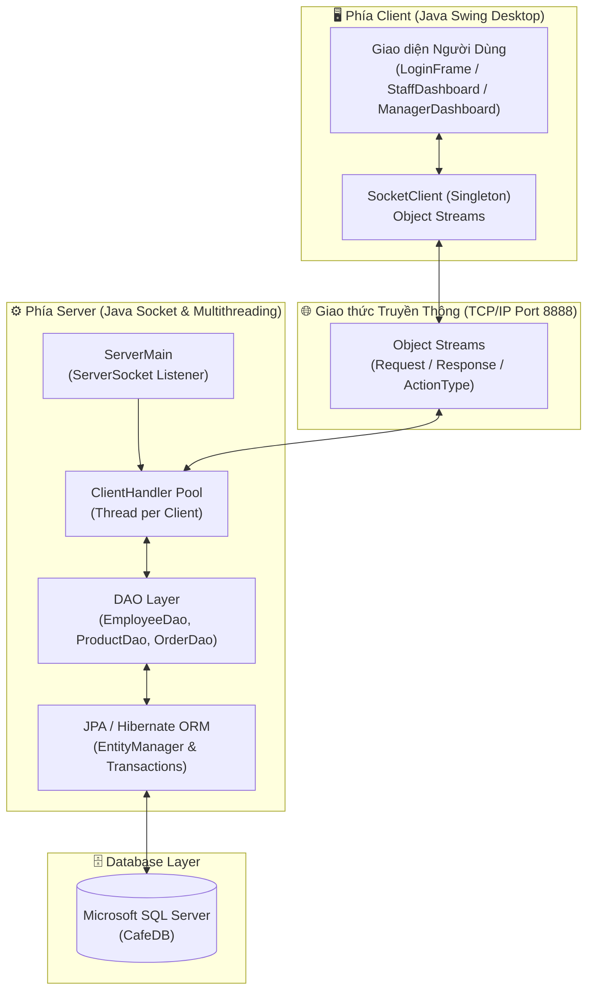
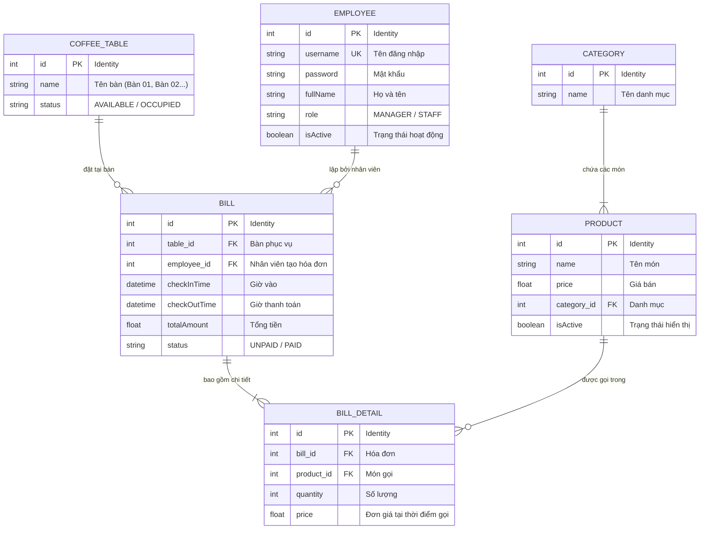

# ☕ Hệ Thống Quản Lý Quán Cafe (Coffee Management System)
### Đồ Án Môn Học: Lập Trình Phân Tán (Distributed Programming) - FIT IUH

[](https://www.oracle.com/java/)
[](https://hibernate.org/orm/)
[](https://jakarta.ee/specifications/persistence/)
[](https://www.microsoft.com/en-us/sql-server)
[](https://docs.oracle.com/javase/8/docs/technotes/guides/swing/)
[](https://maven.apache.org/)

---

## 📖 Giới Thiệu Tổng Quan

**Coffee Management System** là ứng dụng quản lý quán cà phê theo kiến trúc **Client - Server (Lập trình phân tán)** sử dụng giao thức **Java Socket (TCP/IP)**. Hệ thống giải quyết bài toán đồng bộ dữ liệu thời gian thực giữa nhiều máy trạm (quầy thu ngân, nhân viên order, máy quản lý) và xử lý dữ liệu tập trung thông qua **JPA / Hibernate** lưu trữ trên **Microsoft SQL Server**.

### 🌟 Điểm Nổi Bật
* **Mô hình Client - Server Phân Tán:** Hỗ trợ đa máy trạm kết nối đồng thời qua mạng nội bộ (LAN) hoặc Internet.
* **Xử lý Đa luồng (Multi-threading):** Mỗi Client được phục vụ bởi một luồng `ClientHandler` riêng biệt tại Server, đảm bảo phản hồi tức thì và không bị nghẽn mạng.
* **Tự động sinh lược đồ CSDL & Seeder dữ liệu:** Sử dụng `hibernate.hbm2ddl.auto = update` và logic `initDefaultData()`, tự động tạo bảng và nạp sẵn tài khoản, sơ đồ bàn, danh mục món ngay lần đầu khởi chạy.
* **Phân quyền linh hoạt (RBAC):** Giao diện thích ứng theo vai trò người dùng (**Quản lý - MANAGER** và **Nhân viên - STAFF**).
* **Tối ưu hóa truyền thông mạng:** Cơ chế ngắt liên kết đối tượng vòng lặp hai chiều (Circular Reference) trước khi Object Serialization, loại bỏ hoàn toàn lỗi `StackOverflowError`.

---

## 🏗️ Kiến Trúc Hệ Thống (System Architecture)

Hệ thống được tổ chức thành 3 module chính:



### 1. Phân Tách Các Module:
* **`com.cafe.common` (Common Layer):**
  * `entity`: Các thực thể ánh xạ JPA (`Employee`, `Product`, `Category`, `CoffeeTable`, `Bill`, `BillDetail`).
  * `network`: Cấu trúc truyền tải gói tin qua Socket (`Request`, `Response`, `ActionType`, `OrderDto`, `Config`).
* **`com.cafe.server` (Server Layer):**
  * `service.ServerMain`: Điểm vào của máy chủ, mở cổng TCP Socket `8888`, tự động kiểm tra và seed dữ liệu mẫu.
  * `service.ClientHandler`: Tiếp nhận kết nối và điều phối các tác vụ theo từng luồng độc lập.
  * `dao`: Tương tác với cơ sở dữ liệu thông qua JPA (`JPAUtil`, `EmployeeDao`, `ProductDao`, `OrderDao`).
* **`com.cafe.client` (Client Layer):**
  * `socket.SocketClient`: Quản lý kết nối Socket đến Server áp dụng Singleton Pattern. Hỗ trợ cấu hình IP máy chủ động.
  * `ui`: Giao diện đồ họa người dùng bằng Java Swing với Look and Feel hệ điều hành.

---

## 📊 Cơ Sở Dữ Liệu (Database Schema)

Hệ quản trị CSDL: **Microsoft SQL Server (CafeDB)**. Ánh xạ đối tượng thông qua Hibernate ORM.



---

## 🎯 Tính Năng Chi Tiết (Features)

### 1. Đăng Nhập & Cấu Hình Máy Chủ (`LoginFrame`)
* Tự do nhập địa chỉ IP của máy chủ (`Server IP`) để kết nối qua mạng LAN hoặc máy cục bộ (`localhost`).
* Kiểm tra xác thực thông tin đăng nhập, tự động điều hướng sang giao diện tương ứng theo vai trò (`MANAGER` hoặc `STAFF`).

### 2. Dành Cho Nhân Viên Bán Hàng (`StaffDashboardFrame`)
* **Sơ đồ bàn trực quan theo thời gian thực:**
  * 🟢 **Màu xanh lục (AVAILABLE):** Bàn đang trống, sẵn sàng tiếp khách.
  * 🔴 **Màu đỏ (OCCUPIED):** Bàn đang có khách ngồi.
* **Chi tiết Order theo bàn:** Click vào bàn bất kỳ để xem danh sách món ăn/thức uống, số lượng, đơn giá và tổng số tiền hiện tại.
* **Thêm món vào bàn:** Chọn thức uống từ danh mục, nhập số lượng. Nếu món đã có trong hóa đơn, hệ thống tự động cộng dồn số lượng.
* **Thanh toán hóa đơn:** Chốt hóa đơn, tự động ghi nhận `checkOutTime`, chuyển trạng thái hóa đơn sang `PAID` và cập nhật bàn về `AVAILABLE`.
* **Cá nhân:** Xem thông tin nhân viên và thực hiện đổi mật khẩu cá nhân (yêu cầu mật khẩu cũ).

### 3. Dành Cho Quản Trị Viên (`ManagerDashboardFrame`)
* **Quản Lý Món Ăn / Thức Uống (`ProductPanel`):**
  * Thêm món mới, chọn danh mục tương ứng.
  * Cập nhật tên món, đơn giá bán, đổi loại danh mục.
  * Xóa món (áp dụng cơ chế **Soft Delete** với trường `isActive = false` để đảm bảo toàn vẹn dữ liệu lịch sử hóa đơn).
  * Bộ lọc tìm kiếm nhanh theo thời gian thực (Real-time Filter) bằng Regex.
* **Quản Lý Nhân Viên (`EmployeePanel`):**
  * Danh sách tài khoản nhân sự trong toàn hệ thống.
  * Thêm nhân viên mới, cấp tài khoản và phân quyền (`STAFF` / `MANAGER`).
  * Cập nhật thông tin nhân viên, đổi mật khẩu.
  * Vô hiệu hóa/Xóa nhân viên (Soft Delete).
* **Quản Lý Lịch Sử Hóa Đơn (`BillPanel`):**
  * Theo dõi toàn bộ danh sách hóa đơn theo thứ tự mới nhất.
  * Xem thông tin chi tiết: ID, Tên bàn, Nhân viên lập đơn, Giờ khách vào, Giờ khách ra, Tổng tiền, Trạng thái (`UNPAID` / `PAID`).

---

## 📡 Giao Thức Mạng & Các Hành Động (`ActionType`)

Tất cả giao tiếp giữa Client và Server được đóng gói trong đối tượng `Request` và `Response`:

| ActionType | Mô tả tác vụ | Payload (Request) | Dữ liệu trả về (Response Data) |
| :--- | :--- | :--- | :--- |
| `LOGIN` | Đăng nhập tài khoản | `Employee` (username, password) | `Employee` (thông tin người dùng đã xác thực) |
| `GET_CATEGORIES` | Lấy danh mục sản phẩm | `null` | `List<Category>` |
| `GET_PRODUCTS` | Lấy danh sách món đang bán | `null` | `List<Product>` |
| `ADD_PRODUCT` | Thêm món mới | `Product` | `boolean` (thành công / thất bại) |
| `UPDATE_PRODUCT` | Cập nhật thông tin món | `Product` | `boolean` |
| `DELETE_PRODUCT` | Xóa món (Soft Delete) | `int` (productId) | `String` / `boolean` |
| `GET_TABLES` | Lấy sơ đồ trạng thái các bàn | `null` | `List<CoffeeTable>` |
| `GET_ACTIVE_BILL` | Lấy hóa đơn chưa thanh toán của bàn | `int` (tableId) | `Bill` (kèm danh sách `BillDetail`) |
| `ADD_TO_BILL` | Đặt món vào bàn | `OrderDto` (tableId, empId, prodId, qty)| `boolean` |
| `CHECKOUT_BILL` | Thanh toán hóa đơn bàn | `int` (billId) | `boolean` |
| `GET_EMPLOYEES` | Lấy danh sách nhân viên | `null` | `List<Employee>` |
| `ADD_EMPLOYEE` | Thêm nhân viên mới | `Employee` | `boolean` |
| `UPDATE_EMPLOYEE` | Cập nhật nhân viên | `Employee` | `boolean` |
| `DELETE_EMPLOYEE` | Khóa tài khoản nhân viên | `int` (employeeId) | `boolean` |
| `GET_ALL_BILLS` | Lịch sử tất cả hóa đơn | `null` | `List<Bill>` |
| `CHANGE_PASSWORD` | Đổi mật khẩu cá nhân | `Object[]{ empId, newPassword }` | `boolean` |

---

## 📁 Cấu Trúc Thư Mục Dự Án

```
Coffee-Management-Distributed-Programming/
│
├── CafeeManagement/
│   ├── src/
│   │   ├── main/
│   │   │   ├── java/com/cafe/
│   │   │   │   ├── client/
│   │   │   │   │   ├── socket/
│   │   │   │   │   │   └── SocketClient.java       # Bộ điều khiển Socket Client (Singleton)
│   │   │   │   │   ├── ui/
│   │   │   │   │   │   ├── BillPanel.java          # Giao diện quản lý hóa đơn
│   │   │   │   │   │   ├── EmployeePanel.java      # Giao diện quản lý nhân viên
│   │   │   │   │   │   ├── LoginFrame.java         # Màn hình đăng nhập & kết nối IP
│   │   │   │   │   │   ├── ManagerDashboardFrame.java # Bàn làm việc Quản lý
│   │   │   │   │   │   ├── ProductPanel.java       # Giao diện quản lý món & tìm kiếm
│   │   │   │   │   │   └── StaffDashboardFrame.java   # Bàn làm việc Bán hàng & Sơ đồ bàn
│   │   │   │   │   └── ClientMain.java             # Entry point khởi chạy Client
│   │   │   │   │
│   │   │   │   ├── common/
│   │   │   │   │   ├── entity/                     # Các Entity ánh xạ CSDL
│   │   │   │   │   │   ├── Bill.java
│   │   │   │   │   │   ├── BillDetail.java
│   │   │   │   │   │   ├── Category.java
│   │   │   │   │   │   ├── CoffeeTable.java
│   │   │   │   │   │   ├── Employee.java
│   │   │   │   │   │   └── Product.java
│   │   │   │   │   └── network/                    # Các DTO và chuẩn đóng gói Socket
│   │   │   │   │       ├── ActionType.java
│   │   │   │   │       ├── Config.java
│   │   │   │   │       ├── OrderDto.java
│   │   │   │   │       ├── Request.java
│   │   │   │   │       └── Response.java
│   │   │   │   │
│   │   │   │   └── server/
│   │   │   │       ├── dao/                        # Thao tác CSDL bằng JPA
│   │   │   │       │   ├── EmployeeDao.java
│   │   │   │       │   ├── JPAUtil.java
│   │   │   │       │   ├── OrderDao.java
│   │   │   │       │   └── ProductDao.java
│   │   │   │       └── service/
│   │   │   │           ├── ClientHandler.java      # Luồng xử lý từng client kết nối
│   │   │   │           └── ServerMain.java         # Entry point khởi chạy Server & Seeder
│   │   │   │
│   │   │   └── resources/
│   │   │       └── META-INF/
│   │   │           └── persistence.xml             # Cấu hình kết nối JPA và Hibernate
│   │   │
│   │   └── test/
│   │
│   ├── CreateDB.sql                                # Hướng dẫn & Script tạo CSDL CafeDB
│   ├── BaoCaoDoAn.docx                             # Báo cáo đồ án chi tiết (Word)
│   ├── BaoCaoDoAn.html                             # Báo cáo đồ án hiển thị web kèm biểu đồ
│   ├── ThuyetTrinhDoAn.html                        # Slide thuyết trình Reveal.js
│   └── pom.xml                                     # Cấu hình thư viện Maven
│
└── README.md                                       # Tài liệu hướng dẫn sử dụng dự án
```

---

## 🚀 Hướng Dẫn Cài Đặt & Chạy Ứng Dụng

### 1. Yêu Cầu Môi Trường
* **JDK:** Java Development Kit 17 hoặc cao hơn.
* **DBMS:** Microsoft SQL Server 2017+ (đã bật chế độ `SQL Server and Windows Authentication mode` và cấu hình cổng `1433`).
* **IDE Khuyên dùng:** Eclipse IDE for Java Developers, IntelliJ IDEA, hoặc VS Code.
* **Build Tool:** Apache Maven 3.8+.

---

### 2. Thiết Lập Cơ Sở Dữ Liệu
Mở **SQL Server Management Studio (SSMS)** và thực thi lệnh tạo cơ sở dữ liệu rỗng:

```sql
CREATE DATABASE CafeDB;
GO
```

> [!NOTE]
> Nhờ cấu hình `<property name="hibernate.hbm2ddl.auto" value="update"/>` trong `persistence.xml`, bạn **không cần tạo bảng thủ công**. Khi chạy Server, Hibernate sẽ tự động sinh bảng và `ServerMain.java` sẽ tự động chèn dữ liệu mẫu nếu database đang trống.

---

### 3. Cấu Hình Tài Khoản Kết Nối CSDL
Mở tệp: [`CafeeManagement/src/main/resources/META-INF/persistence.xml`](CafeeManagement/src/main/resources/META-INF/persistence.xml)

Kiểm tra và sửa thông tin tài khoản SQL Server của bạn:
```xml
<!-- MSSQL Server Connection Settings -->
<property name="jakarta.persistence.jdbc.driver" value="com.microsoft.sqlserver.jdbc.SQLServerDriver"/>
<property name="jakarta.persistence.jdbc.url" value="jdbc:sqlserver://localhost:1433;databaseName=CafeDB;encrypt=true;trustServerCertificate=true;"/>
<property name="jakarta.persistence.jdbc.user" value="sa"/>
<property name="jakarta.persistence.jdbc.password" value="123456"/>
```

---

### 4. Khởi Chạy Ứng Dụng

#### Cách 1: Chạy trực tiếp từ IDE (Eclipse / IntelliJ IDEA)
1. **Khởi chạy Server trước:**
   * Mở file `com.cafe.server.service.ServerMain.java`.
   * Nhấp chuột phải chọn **Run As -> Java Application**.
   * Quan sát Console: Khi thấy thông báo `Cafe Server is running on port 8888` là server đã sẵn sàng.
2. **Khởi chạy một hoặc nhiều Client:**
   * Mở file `com.cafe.client.ClientMain.java`.
   * Nhấp chuột phải chọn **Run As -> Java Application**.
   * Đăng nhập và bắt đầu sử dụng. (Bạn có thể chạy nhiều `ClientMain` cùng lúc để thử nghiệm việc đồng bộ giữa các máy).

#### Cách 2: Biên dịch và chạy bằng lệnh Maven
Tại thư mục `CafeeManagement/`:
```bash
# 1. Tải dependencies và biên dịch dự án
mvn clean compile

# 2. Chạy Server
mvn exec:java -Dexec.mainClass="com.cafe.server.service.ServerMain"

# 3. Mở một terminal mới để chạy Client
mvn exec:java -Dexec.mainClass="com.cafe.client.ClientMain"
```

---

## 🔑 Tài Khoản Đăng Nhập Mặc Định

Hệ thống được khởi tạo sẵn 2 tài khoản thử nghiệm:

| Tên Đăng Nhập | Mật Khẩu | Vai Trò (Role) | Chức Năng Chính |
| :--- | :--- | :--- | :--- |
| **`admin`** | `123456` | **MANAGER** (Quản lý) | Toàn quyền: Quản lý Menu món, Quản lý Nhân sự, Xem lịch sử hóa đơn |
| **`staff`** | `123456` | **STAFF** (Nhân viên) | Sơ đồ bàn, Tiếp nhận order đặt món, Thanh toán chốt bill, Đổi mật khẩu |

---

## 🛠️ Khắc Phục Lỗi Thường Gặp (Troubleshooting)

1. **Lỗi kết nối CSDL (`Failed to connect to Database`):**
   * Kiểm tra dịch vụ SQL Server Browser và SQL Server TCP/IP đã được Enabled trong *SQL Server Configuration Manager*.
   * Đảm bảo mật khẩu và tên user trong `persistence.xml` trùng khớp với tài khoản `sa` của máy bạn.
   * Đảm bảo đã chạy câu lệnh `CREATE DATABASE CafeDB;`.
2. **Lỗi kết nối Client đến Server (`Không thể kết nối đến máy chủ`):**
   * Đảm bảo `ServerMain` đã được khởi chạy trước khi mở `ClientMain`.
   * Nếu chạy trên nhiều máy khác nhau trong mạng LAN, hãy nhập đúng địa chỉ IP IPv4 của máy chủ Server (ví dụ `192.168.1.15`) tại ô **Máy chủ (Server IP)** trên màn hình đăng nhập và mở cổng firewall `8888` trên máy chủ.
3. **Lỗi `Port already in use: 8888`:**
   * Cổng 8888 đang bị chiếm dụng bởi một tiến trình Server cũ chưa đóng. Tắt tiến trình cũ hoặc khởi động lại IDE.

---

## 🔮 Hướng Phát Triển Tiếp Theo

- [ ] Mã hóa băm mật khẩu người dùng (sử dụng **BCrypt** hoặc **Argon2**) thay cho plain-text.
- [ ] Nâng cấp giao diện Java Swing sang giao diện hiện đại với bộ giao diện **FlatLaf** (Dark/Light Mode).
- [ ] Tích hợp tính năng in hóa đơn ra máy in nhiệt bill (POS Printer).
- [ ] Thêm module vẽ biểu đồ thống kê báo cáo doanh thu theo ngày/tháng/năm với JFreeChart.
- [ ] Phát triển Client phiên bản Web / Mobile qua RESTful API hoặc WebSockets.

---

## 👥 Tác Giả & Đồ Án

* **Môn học:** Lập Trình Phân Tán (Distributed Programming)
* **Khoa:** Khoa Công Nghệ Thông Tin (FIT) - Trường Đại học Công nghiệp TP.HCM (IUH)
* **Nhóm tác giả:** Sinh viên ngành Kỹ thuật Phần mềm / Khoa học Máy tính
